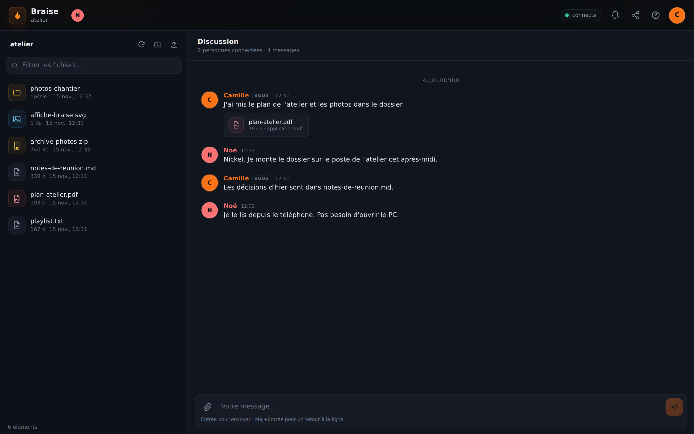
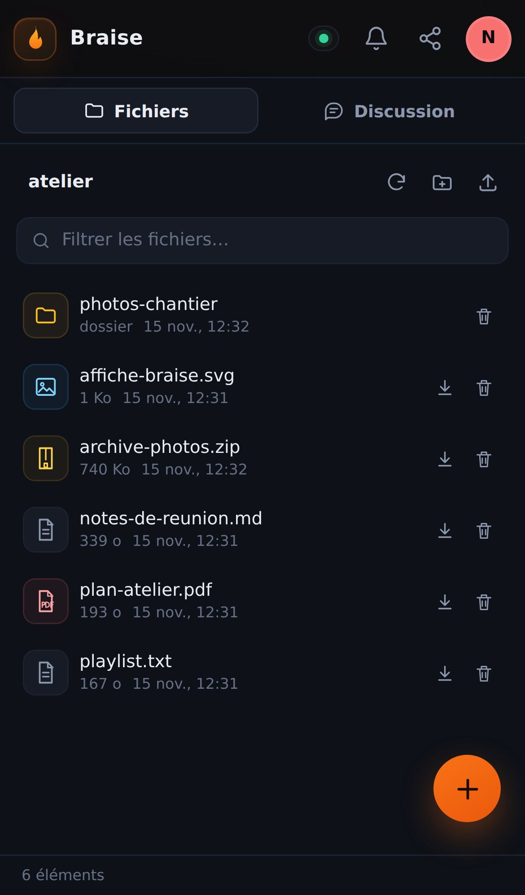
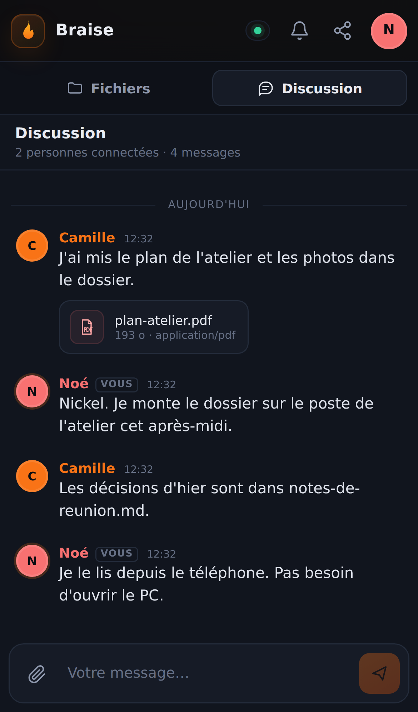
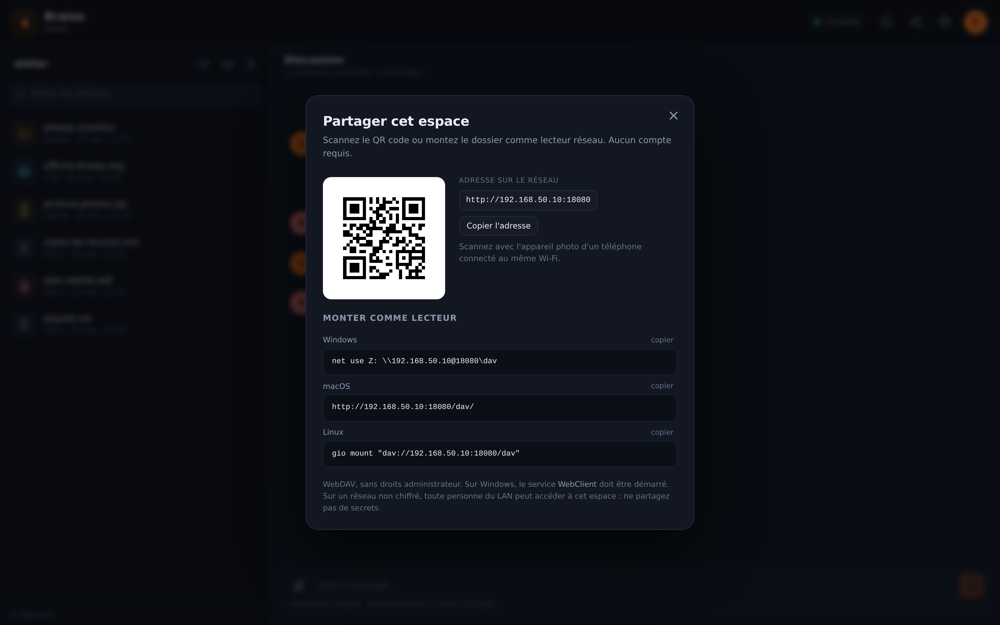
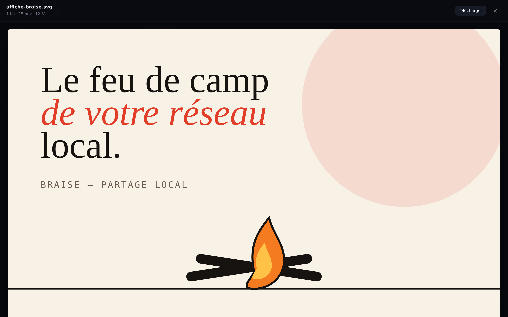

# Braise

> Le feu de camp de votre réseau local.

**Braise** est une petite application de partage de fichiers et de discussion pour un même réseau local. Un seul binaire Go embarque le serveur, l'interface web, le chat en SSE et un point de montage WebDAV. Pas de cloud, pas de compte obligatoire, pas de base de données externe.

**Site** : [foudroyant.github.io/braise](https://foudroyant.github.io/braise/) · **Téléchargements** : [dernière version](https://github.com/foudroyant/braise/releases/latest)

- **Un binaire, une interface web embarquée** : lancez `braise`, ouvrez l'URL affichée.
- **Mobile inclus** : la même interface s'adapte au téléphone ; le QR code permet de rejoindre l'espace en un scan, et les mobiles peuvent déposer leurs propres fichiers.
- **Chat en temps réel** avec SSE, présence, indicateur de saisie, historique local.
- **Notifications** : badge et compteur dans l'onglet, alertes intégrées, notifications système quand le navigateur l'autorise, son et vibration.
- **Dossier partagé** : dépôt par glisser-déposer, upload multiple, aperçus, recherche, corbeille.
- **Montage réseau** : WebDAV sur `/dav/`, sans droits administrateur, pour monter le dossier comme lecteur sous Windows, macOS ou Linux.

## Aperçu

| Bureau | Mobile — fichiers | Mobile — discussion |
| --- | --- | --- |
|  |  |  |

| Partage / QR | Aperçu de fichier |
| --- | --- |
|  |  |

## Démarrage rapide

Prérequis : Go 1.26 ou plus récent pour compiler, aucun pour le binaire.

Le plus simple est de lancer Braise sans option. Il crée alors le dossier `~/Braise` sous macOS et Linux, ou `%USERPROFILE%\Braise` (`C:\Users\<vous>\Braise`) sous Windows.

**macOS / Linux**

```bash
go run .
# ou
go build -o braise .
./braise
```

**Windows (PowerShell)**

```powershell
go run .
# ou
go build -o braise.exe .
.\braise.exe
```

Avec un binaire téléchargé, double-cliquez sur `braise-windows-amd64.exe`, ou lancez `.\braise-windows-amd64.exe` dans PowerShell.

> `~` est un raccourci de shell Unix, pas une syntaxe Windows. Braise ne l'interprète pas lui-même. `-/Braise` n'existe pas ; `/Braise` désigne la racine du disque courant, pas votre dossier personnel. Sous Windows, utilisez `--dir C:\Braise` ou `--dir %USERPROFILE%\Braise`, ou omettez `--dir`.

Au lancement, Braise :

1. crée le dossier partagé s'il n'existe pas ;
2. écoute sur `0.0.0.0:8080` ;
3. affiche les adresses locale et réseau ;
4. ouvre le navigateur sur `http://localhost:8080` (sauf `--no-open`).

Les autres appareils du LAN ouvrent `http://<ip-du-serveur>:8080` ou scannent le QR code depuis le bouton **Partager**.

### Binaires

| Système | Fichier |
| --- | --- |
| Windows x86_64 | [`braise-windows-amd64.exe`](https://github.com/foudroyant/braise/releases/latest/download/braise-windows-amd64.exe) |
| macOS Apple Silicon | [`braise-darwin-arm64`](https://github.com/foudroyant/braise/releases/latest/download/braise-darwin-arm64) |
| macOS Intel | [`braise-darwin-amd64`](https://github.com/foudroyant/braise/releases/latest/download/braise-darwin-amd64) |
| Linux x86_64 | [`braise-linux-amd64`](https://github.com/foudroyant/braise/releases/latest/download/braise-linux-amd64) |
| Linux ARM64 | [`braise-linux-arm64`](https://github.com/foudroyant/braise/releases/latest/download/braise-linux-arm64) |

Empreintes SHA-256 : [`checksums.txt`](https://github.com/foudroyant/braise/releases/latest/download/checksums.txt). Les binaires ne sont pas signés : macOS peut demander une autorisation dans **Réglages → Confidentialité et sécurité**, Windows peut afficher SmartScreen.

Pour compiler soi-même les cinq cibles :

```bash
make dist
```

### Options

```
--dir        dossier partagé (défaut : ~/Braise, ou %USERPROFILE%\Braise sous Windows)
--bind       adresse d'écoute (défaut : 0.0.0.0)
--port       port HTTP (défaut : 8080)
--name       nom affiché de l'espace
--read-only  dépôt, création et suppression interdits
--no-open    ne pas ouvrir le navigateur
--no-mdns    désactiver l'annonce braise.local
--version    afficher la version
```

## Mobile

L'interface bascule automatiquement en deux onglets **Fichiers** / **Discussion** sous 900 px. Le bouton **+** ouvre le sélecteur de fichiers du téléphone (photos, caméra, fichiers). Les fichiers déposés apparaissent immédiatement sur les autres appareils via SSE.

Sur iPhone/iPad, « Partager → Sur l'écran d'accueil » donne un affichage plein écran. Android propose l'ajout à l'écran d'accueil selon le navigateur. Le service worker et l'installation PWA complète demandent HTTPS, ce qui n'est pas le cas par défaut sur un LAN en HTTP.

## Monter le dossier comme lecteur

Depuis le bouton **Partager** :

| Système | Commande / chemin |
| --- | --- |
| Windows | `net use Z: \\192.168.1.20@8080\dav` |
| macOS | Finder → Aller → Se connecter au serveur → `http://192.168.1.20:8080/dav/` |
| Linux | `gio mount "dav://192.168.1.20:8080/dav"` |

Remarques :

- Sous Windows, le service **WebClient** doit être démarré (`services.msc`). L'accès anonyme fonctionne sur un réseau de confiance ; si Windows réclame des identifiants, utilisez l'interface web ou un client WebDAV tiers.
- WebDAV est volontairement choisi à la place de SMB/NTFS : pas d'élévation, pas de port 445, pas de modification des ACL, fonctionne sur Windows/macOS/Linux, et le même dossier reste accessible dans le navigateur.

## Notifications : ce qu'il faut savoir

L'API `Notification` du navigateur exige un **contexte sécurisé** : HTTPS, `localhost` ou `127.0.0.1`. Sur `http://192.168.x.x`, Chrome/Safari refusent les notifications système.

Braise s'adapte :

- **hôte sur localhost** : notifications système possibles après clic sur la cloche ;
- **invités en HTTP sur le LAN** : alerte dans l'application (toast), badge dans l'onglet, compteur, son et vibration ;
- **HTTPS local** (roadmap) : notifications système et PWA sur tout le LAN.

## Sécurité

Braise est pensé pour un **réseau de confiance**. Il n'y a pas d'authentification par défaut : toute personne qui atteint le port peut lire, déposer et discuter. Mesures présentes :

- écoute sur le LAN, jamais d'annonce d'adresse publique ;
- chemins confinés à la racine, refus des symlinks et du dossier `.braise` ;
- vérification `Origin` sur les mutations, en-têtes CSP/nosniff ;
- limite d'envoi et noms de fichiers assainis ;
- `--read-only` pour un partage en consultation ;
- aucune télémétrie, aucun appel sortant.

Pour un réseau non fiable, attendez la V1 (PIN par espace, liens signés, HTTPS local) ou isolez le port dans votre pare-feu. Sur Windows, autorisez Braise uniquement sur le profil **Privé**.

## Données

```
<dossier partagé>/
  .braise/
    events.jsonl   # messages + événements fichiers
    trash/         # suppressions récupérables
    tmp/           # envois en cours
```

V0 utilise un journal JSONL append-only, chargé en mémoire. La migration vers SQLite (FTS5) est prévue en V1.

## Architecture

```
main.go                    flags, démarrage, mDNS, arrêt propre
internal/server/           API HTTP, SSE, middlewares, QR
internal/store/            journal d'événements et messages
internal/sse/              fan-out SSE + présence
internal/files/            chemins sûrs, upload, corbeille, MIME
internal/dav/              WebDAV confiné
internal/netutil/          IP LAN, ouverture navigateur
web/                       UI embarquée (HTML/CSS/JS, zéro build)
```

- Go standard library pour le routage (`GET /api/...`), `log/slog`, `embed`.
- `golang.org/x/net/webdav` pour le montage.
- `github.com/skip2/go-qrcode` pour le QR.
- `github.com/grandcat/zeroconf` pour `braise.local`.
- SSE : IDs d'événements, rejeu via `Last-Event-ID`, heartbeat 15 s, reconnexion automatique.

## API

| Méthode | Route | Rôle |
| --- | --- | --- |
| GET | `/api/info` | nom, dossier, URLs, mode |
| GET | `/api/events` | flux SSE (`message`, `file`, `presence`, `typing`) |
| GET/POST | `/api/messages` | historique / envoi |
| GET | `/api/files?path=` | liste un dossier |
| POST | `/api/upload?path=` | upload multipart |
| GET | `/api/download?path=` | téléchargement (Range) |
| GET | `/api/raw?path=` | aperçu inline (CSP sandbox) |
| POST | `/api/mkdir`, `/api/delete` | dossiers / corbeille |
| POST | `/api/presence`, `/api/typing` | présence / saisie |
| GET | `/api/qr?url=` | QR code PNG |
| * | `/dav/` | WebDAV |

Toutes les mutations acceptent l'en-tête `X-Braise-Peer: <id>` pour attribuer l'action à un pair.

## Feuille de route

- **V1** : SQLite/FTS5, liens de partage expirants avec PIN, upload résumable, aperçus plus riches, PIN d'espace.
- **V2** : notifications natives via mode tray, HTTPS local avec CA générée, SMB Windows **opt-in** (PowerShell `New-SmbShare`, groupe dédié, lecture seule par défaut), PWA.
- **Plus tard** : envoi direct P2P (WebRTC, signalisation SSE), versions de fichiers, quotas.

## Tests manuels effectués

- API chat/SSE, upload, download avec `Range`, QR, WebDAV `PROPFIND`/`GET`/`PUT`.
- Refus du dossier `.braise`, des traversées de chemin et des origines étrangères.
- Parcours Playwright desktop 1440×900 et mobile iPhone 13 : identité, message temps réel, upload, aperçu, partage, présence.

## Licence

À définir.
